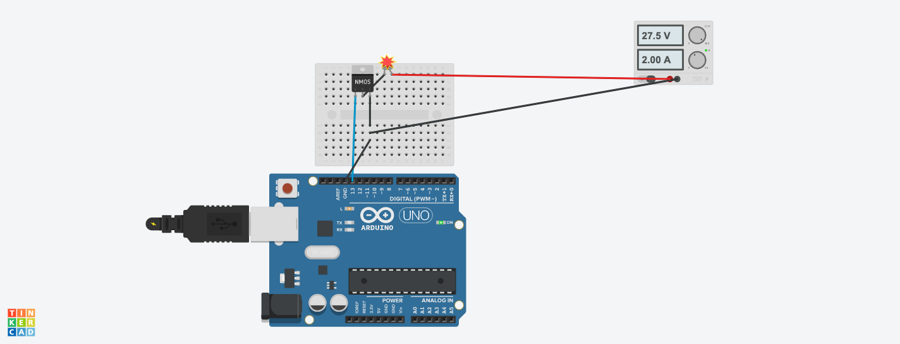

<div align="center">

# Light Stimulation Device (LSD)

**Open-source stroboscopic light for research and psychedelic therapy.**

[](https://creativecommons.org/licenses/by-nc/4.0/)

</div>

---

## 🧭 About

The Light Stimulation Device (LSD) is an open-source hardware project that uses flickering LED arrays to produce stroboscopic visual stimulation at specific brainwave frequencies. The device cycles through programmable sequences of beta, alpha, delta, theta, and gamma frequencies, creating closed-eye visual experiences used in meditation, consciousness research, and therapeutic settings.

Built on Arduino, the total parts cost is under $100.

## ⚠️ Disclaimer

**Use of the LSD is at your own risk. This device is provided for research and entertainment purposes only.** Stroboscopic light can trigger seizures in individuals with photosensitive epilepsy. Consult a medical professional before use.

## ✨ Features

- Programmable brainwave frequency sequences (beta, alpha, delta, theta, gamma)
- Customizable session duration and frequency transitions
- Serial monitor output for real-time session tracking
- Simple Arduino-based design with minimal components
- Two build variants: MICRO (single LED) and MACRO (multi-LED + halogen)

## 📐 Variants

| Variant | Description | LEDs | MOSFETs | Target Cost |
|---------|-------------|------|---------|-------------|
| **LSD MICRO** | Minimal single-LED build for getting started quickly | 1 LED chip array | 1 | ~$50 |
| **LSD MACRO** | Multi-LED + halogen bulb design inspired by the Lucia No. 3 | 8 LED chips + 1 halogen | 4 | ~$100 |

The MICRO produces a surprisingly similar effect to the MACRO despite its simpler design, making it a great starting point.

## 🧠 Brainwave Frequencies

The firmware drives the LED at frequencies corresponding to standard EEG brainwave bands:

| Band | Frequency | Associated State |
|------|-----------|-----------------|
| Delta | 3 Hz | Deep sleep |
| Theta | 6 Hz | Meditation, drowsiness |
| Alpha | 12 Hz | Relaxed awareness |
| Beta | 22 Hz | Active thinking |
| Gamma | 30 Hz | Higher cognition |

Sequences are defined as arrays in the Arduino sketch and can be freely edited to create custom sessions.

## 🔧 LSD MICRO Parts List

| Qty | Part | Notes |
|-----|------|-------|
| 1 | Arduino Uno | |
| 1 | MOSFET | |
| 1 | 36V power supply | |
| 1 | USB cable | |
| 1 | LED chip array | [Amazon link](http://amazon.com/dp/B07VFHP5P5/) |
| — | Misc. wires / jumpers | |
| 1 | Laptop running Arduino IDE | |

**Optional:** Protoshield, Arduino Uno project case.

### MICRO Wiring Diagram

<div align="center">

</div>

## 🔧 LSD MACRO Parts List

| Qty | Part |
|-----|------|
| 1 | Arduino Uno |
| 4 | MOSFETs |
| 1 | Power supply |
| 1 | USB cable |
| 8 | 10W LED chips |
| 1 | 10W halogen bulb |
| 1 | Halogen bulb holder |
| — | Misc. wires / jumpers |
| 1 | Laptop running Arduino IDE |

**Optional:** Protoshield, Arduino Uno project case.

> **Note:** The Lucia No. 3 is a patented product. Commercial production or sale of the LSD MACRO may violate patent law.

## 🚀 Getting Started

1. Assemble the hardware using the parts list and wiring diagram above.
2. Install the [Arduino IDE](https://www.arduino.cc/en/software).
3. Open `micro/LSD-MICRO.ino` in the Arduino IDE.
4. Edit the `sequence[]` array to customize your session (frequency and duration pairs).
5. Upload to your Arduino Uno and open the Serial Monitor at 9600 baud.
6. Close your eyes, position the LED array in front of your face, and start the session.

## 🗂️ Repository Structure

```
├── micro/
│   ├── LSD-MICRO.ino          # Arduino firmware
│   ├── LSD-MICRO.brd          # PCB board file
│   ├── LSD-MICRO-PartsList    # Parts list
│   └── LSD_MICRO.png          # Wiring diagram
├── macro/
│   └── LSD-MACRO-PartsList    # Parts list
├── LICENSE
└── README.md
```

## 📄 License

This work is licensed under [Creative Commons Attribution-NonCommercial 4.0 International (CC BY-NC 4.0)](https://creativecommons.org/licenses/by-nc/4.0/).

You are free to share and adapt this work for non-commercial purposes with appropriate attribution.

---

<div align="center">

Provided as a public utility by <a href="https://earthpilot.org"></a> [Earth Pilot](https://earthpilot.org) — Mission Support for Spaceship Earth.

</div>
